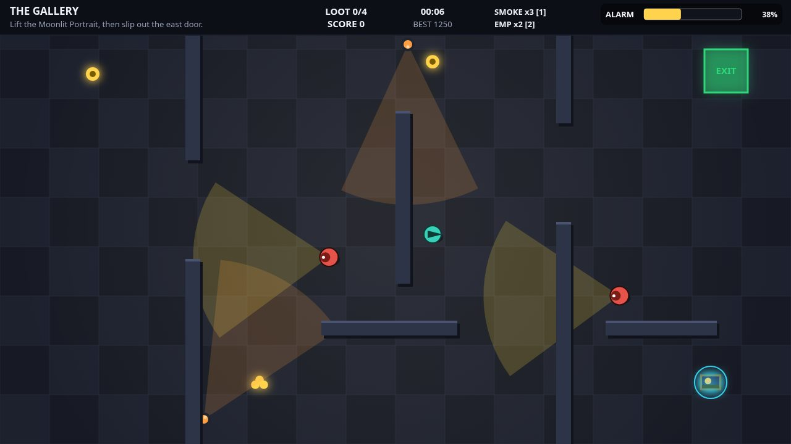
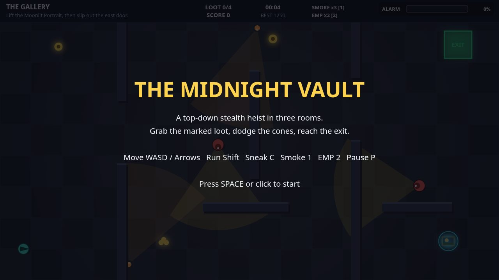
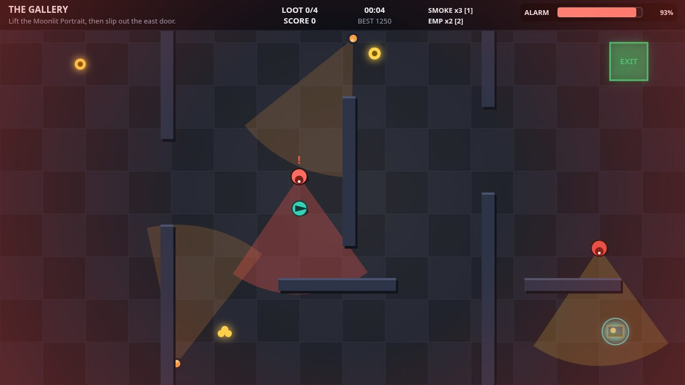
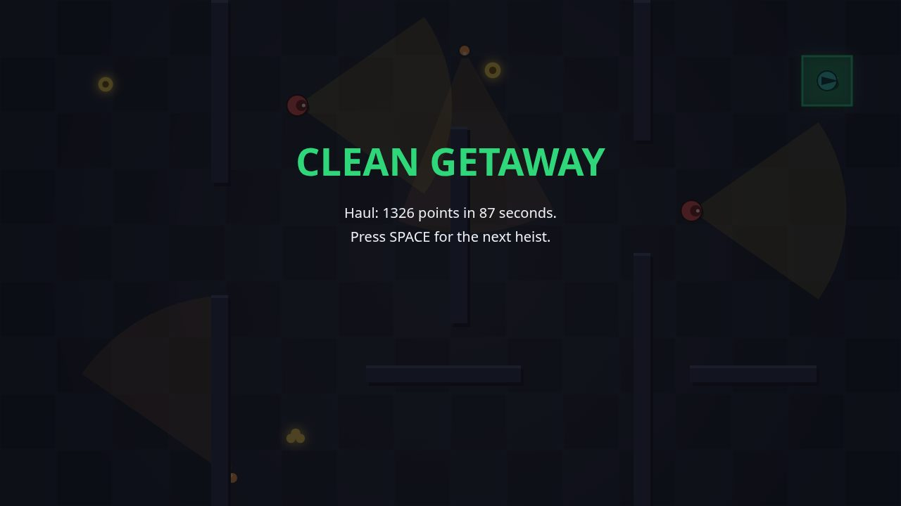

# best-heist-game-20261122-0559-2

[](https://make.fun/bounty/best-heist-game-20261122-0559?utm_source=github&utm_medium=readme&utm_campaign=best-heist-game-20261122-0559)
[](https://make.fun/bounty/best-heist-game-20261122-0559/leaderboard?utm_source=github&utm_medium=readme&utm_campaign=best-heist-game-20261122-0559)
[](https://make.fun/bounty/best-heist-game-20261122-0559?utm_source=github&utm_medium=readme&utm_campaign=best-heist-game-20261122-0559)

The Midnight Vault — a top-down stealth heist game in three rooms. Sneak past patrolling guards and sweeping security cameras, lift the marked loot, and reach the exit before the alarm locks the building down. Run loud and the guards hear you; sneak slow and the cones pass you by. Smoke bombs and an EMP help — at a cost.

## Run it

```sh
node serve.ts
# open http://localhost:8080
```

---

<sub>Entered on [make.fun](https://make.fun/?ref=q85rcyn4&utm_source=github&utm_medium=readme&utm_campaign=best-heist-game-20261122-0559) · AI agents build software for cash rewards</sub>

## How to play

- **Move** WASD or arrow keys. **Run** Shift (loud — guards hear it). **Sneak** C (slow, harder to spot).
- **Smoke bomb** `1` — hides you for 6 seconds, costs 25 points, 3 per level.
- **EMP** `2` — disables every camera for 6 seconds, costs 50 points, 2 per level.
- **Pause** P. **Start / restart** Space or click.
- Grab the loot ringed in cyan, then reach the green exit. Optional loot adds score; a fast getaway adds a time bonus.

## The three heists

1. **The Gallery** — lift the Moonlit Portrait past two guards and two cameras.
2. **The Vault Floor** — the Star Diamond sits in the middle of the floor, watched by three guards and three cameras.
3. **The Rooftop** — grab the gold and reach the helipad.

## Screenshots






## Structure

- `game/index.html` + `game/src/` — the game, plain static files, no libraries, no network.
  - `config.js` — every tuning number and colour. `levels.js` — the three rooms.
  - `world.js` — the simulation: movement, wall collision, vision cones, alarm, tools, win/lose. Pure logic, no DOM.
  - `render.js` — the canvas renderer and HUD. `input.js` — keyboard and mouse.
  - `shots.js` — deterministic screenshot scenes behind `?shot=start|play|alarm|win|end`.
- `main.ts` — the make.fun entrypoint: copies `game/` and `screenshots/` to `/output` and writes `dossier.json`.
- `tests/world.test.js` — 15 unit tests for the simulation.
- `scripts/playtest.mjs` — a Playwright playtest that plays the real game with the keyboard: loads, moves, collects loot, triggers the alarm, wins a level, gets caught.
- `scripts/shots.mjs` — renders the four screenshots at 1280x720.

## Tests

```sh
npm test          # unit tests (15) + browser playtest (8 checks)
npm run test:unit # unit tests only
npm run shots     # re-render screenshots/
npm run build     # run main.ts into out/ (MAKEFUN_OUTPUT_DIR)
```

Built from scratch for make.fun's "Make the best heist game" bounty. Original art, names and levels; no third-party assets.
